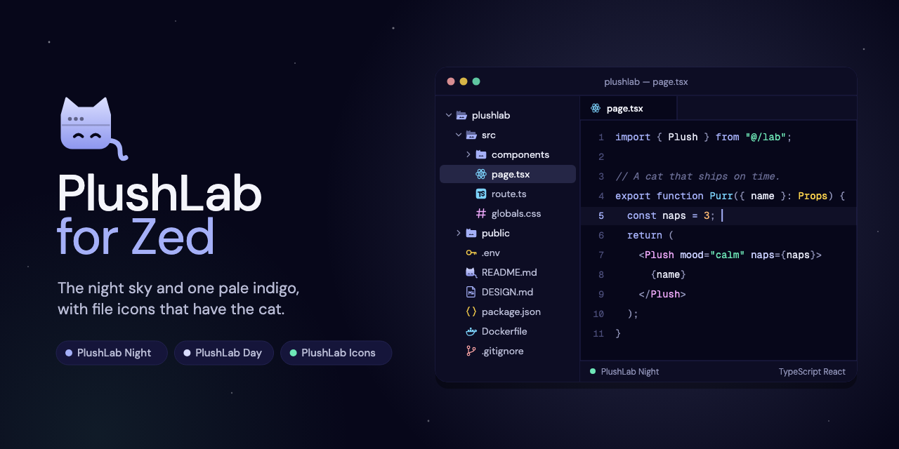

<p align="center"></p>

# PlushLab for Zed

PlushLab's look in your editor: the night sky and one pale indigo accent, with
mint for what's added and rose for what's gone.

- **PlushLab Night** — a dark theme, soft on the eyes for long sessions.
- **PlushLab Day** — its light counterpart.
- **PlushLab Icons** and **PlushLab Icons Light** — folders with cat ears, the
  PlushLab cat on your READMEs, and an icon for each kind of file.

## Install

1. Get the extension:

   ```sh
   git clone https://github.com/TechCorner-Solutions/plushlab-zed.git
   ```

2. In Zed: ⌘⇧P › **zed: install dev extension**, and pick the `plushlab-zed`
   folder.
3. Pick the theme: ⌘K ⌘T › **PlushLab Night** (or **PlushLab Day**).
4. Pick the icons: ⌘⇧P › **icon theme selector: toggle** › **PlushLab Icons**.

## Update

```sh
cd plushlab-zed
git pull
```

then in Zed: ⌘⇧P › **zed: rebuild dev extension**.

To follow your system's light and dark mode, add this to your Zed settings
(⌘,):

```json
{
  "theme": { "mode": "system", "dark": "PlushLab Night", "light": "PlushLab Day" },
  "icon_theme": { "mode": "system", "dark": "PlushLab Icons", "light": "PlushLab Icons Light" }
}
```

## File icons

| Icon for | Files |
| --- | --- |
| The PlushLab cat | `README`, `README.md`, `DESIGN.md` |
| TypeScript, JavaScript, React | `.ts` `.mts` `.cts`, `.js` `.mjs` `.cjs`, `.tsx` `.jsx` |
| Data and config | `.json` `.jsonc`, `.toml` `.yaml` `.yml` `.ini` `.xml`, `.env` |
| Web | `.html`, `.css` `.scss` `.sass` `.less`, images and `.svg` |
| Docs | `.md` `.mdx`, `.txt` `.log`, `LICENSE` |
| Databases | `.sql` `.prisma` `.db` `.sqlite` |
| Tooling | git files, `Dockerfile` and compose files, lock files, shell scripts and `Makefile`, tests (`.test.*`, `.spec.*`) |
| Languages | Rust, Python, Go |

Everything else gets a plain file icon in the theme's colours.

## Note

Zed draws its own toolbar and status-bar icons; extensions can't replace them.
The themes recolour them to match.
